# Wind Power Stochastic Dynamic Economic Dispatch Model (Python & Matlab Code)

Contents
0. Preface
1 Introduction
1.1 Opportunity Constraint Planning
1.2 Scenario-based approach
1.3 Fuzzy Model
2. Description of six models for stochastic dynamic economic dispatch in wind power
2.1 Deterministic Model Considering Positive and Negative Rotation Reserve Constraints
2.2 Opportunity-constrained stochastic models [Opportunity]
2.3 Random Model Based on Probabilistic Optimal Power Flow (POPF) [Opportunity]
2.4 Deterministic Model Based on Scenario Method [Scenario]
2.5 Deterministic Model Considering Limiting Scenarios [Scenario]
2.6 Deterministic Model Based on Sample Mean Method
3 Summary and Outlook
4. Random Economic Scheduling (Matlab Implementation)
4.1 Preparation before the code
4.2 Code
5. Renewable Energy System Scenario Modeling (including shore-to-ship power and electric vehicles)
0 Preface: The primary challenge posed by the large-scale integration of wind power into the grid is how to manage its randomness and mitigate its impact on the optimization of power system dispatch. Modeling is a core step in the optimization of large-scale wind power grid systems, hence we reviewed several typical modeling methods for economic dispatch of wind power integration. Additionally, a stochastic economic dispatch program was employed.
1 Introduction The impact of wind power grid connection on economic dispatch primarily lies in how to handle the randomness of wind power output, aiming to reduce its uncertainty's influence on dispatch results. Therefore, in related models, the current research focus is mainly on the differences in methods for handling the randomness of wind power. Based on the different approaches to dealing with the randomness of wind power, the commonly used modeling methods for wind power economic dispatch problems are mainly divided into opportunity-constrained programming methods, scenario-based methods, and fuzzy mode.
1.1 Opportunistic Constraints in Probabilistic Planning
In economic dispatch problems, due to the uncertainty of wind power generation, the results are inevitably conservative after deterministic treatment of constraints. Stochastic opportunistic constraint programming is an important branch of stochastic programming, mainly addressing optimization problems with stochastic constraints, where decisions must be made before observing the realization of random variables. Considering that decisions made under adverse conditions may not meet the constraints, it is allowed for decisions to be somewhat inconsistent with the constraints. However, decisions should ensure that the probability of constraint violation does not fall below a certain confidence level. The general form of opportunistic constraint programming is:

Edit
In formula (1), f(x) is the objective function; X is the decision vector; ξ is the parameter vector; g(x,ξ) ≤0 is the constraint condition; α is the confidence level; Pr{~} is the probability.

1.2 Scenario-Based Approaches
The scenario-based approach is an important tool for solving stochastic process problems. Heitsch H, Romisch W et al. have conducted many studies on proving scenario trees and their applications, discussing the application of scenario tree methods in multi-stage stochastic processes, and detailing the generation, reduction, and reconstruction methods of scenario trees.

1) Currently, the traditional approach is to reduce scenarios while ensuring a certain degree of accuracy, divided into three steps: scenario generation, scenario reduction, and scenario tree reconstruction.
(1) The safety constraint unit combination method proposed in related articles considers the reactive characteristics of wind turbine generator sets, enhancing computational time and accuracy by introducing generator power allocation coefficients and replacing Monte Carlo simulation-based scenario methods with extreme value set-based scenario methods.
(2) A method based on scenario-based approaches has been proposed to dynamically reduce multi-cut methods. Initially, the integrated random generation unit commitment is decomposed into primary and sub-problems. The primary problem is used to determine the operational status of the generating units and corresponding output dispatching in line with the forecasted wind power conditions, while the sub-problem is used to determine the corresponding generation volume in line with the sampling situation. Subsequently, the primary and sub-problems are linked through optimal cuts, solving them alternatively.
The second approach involves utilizing decomposition acceleration algorithms and high-performance computing devices to directly solve optimization models including large-scale wind farm scenarios. The American ANL has taken a leading role in this approach, applying the SAA method to the stochastic programming problem of the Illinois grid.
Firstly, they apply the SAA method to transform the stochastic problem into an optimal deterministic problem; then, they use the interior-point method to solve this deterministic model. During the iteration process, the coefficient matrix of the equation is rearranged into block diagonal form (BBDF) according to the order of predicted and deviated scenarios. Gaussian elimination with Schur complement is employed to accelerate the solution of the correction equation. Particularly in some studies, involving 195 million variables and 16384 scenarios, the algorithm was compiled and run on supercomputers such as Titan Cray XK7. The inclusion of Schur complement in Gaussian elimination allows the interior-point method to achieve parallel computation effects, which is adopted by commercial software packages OOPS and IPOPT.
1.3 The basic idea of fuzzy modeling is to treat uncertain wind power output as a fuzzy number, performing fuzzy processing on the wind farm output through membership functions, establishing wind farm output membership functions. The larger the value, the higher the decision-maker's satisfaction with the wind farm output. At the same time, establish objective functions and constraints conditions membership functions, including total cost membership function editor, load balance membership function editor, and rotation reserve membership function editor. Then, according to the maximization and minimization laws of fuzzy sets, define the global membership as the fuzzy satisfaction index of the entire model:
Editor
The pursuit of a model solution is transformed into seeking the maximum value of the satisfaction index ω0, which satisfies the constraints. The value of Ω0 reflects the dispatcher's overall satisfaction with the optimized results, including total purchase electricity costs, load balancing, and spinning reserves. When the value of Ω0 is close to or equal to 1, it indicates that the optimized dispatch results meet the dispatcher's requirements.
2. Six Models for Dynamic Economic Dispatch of Wind Power Considering Stochasticity
Model Description 2.1 Deterministic Model Considering Negative Spinning Reserve Constraints
Model I is a deterministic model considering the output of wind farms. It treats the forecasted wind farm output as known factors, and by preserving sufficient system spinning reserve capacity, it addresses the impacts of wind power output uncertainty and load forecast errors. The positive spinning reserve capacity compensates for overestimated wind power output or underestimated system load impacts, while the negative spinning reserve capacity compensates for underestimated wind power output or overestimated system load impacts. Thus, the optimized generation dispatch plan has sufficient system spinning reserve capacity to cope with deviations in the actual wind farm output or load power from the forecast the next day. The mathematical model is as follows:
Among them, formula (1a) is the objective function, defined as the purchase electricity cost. Constraints (1b)-(1g) are the same as constraints (4b)-(4g), for the output variables of conventional power units and wind turbine output variables, removing the superscript related to the scheme equates to optimizing a single forecasting scheme. Constraint (1h) is the system's positive and negative rotational reserve constraints. In the current optimization model, using spinning reserves to cope with the uncertainty in system dispatching brought about by wind power grid connection is a widely used method. To ensure a standard for comparing several models, we only consider the error in wind power forecasting, without considering the error in load forecasting. Among them, the first and second equations represent the system's positive and negative rotational reserve constraints, Sut and Sdt are the positive and negative rotational reserve capacities of the system at time interval t; ​edit is the collective power of the wind farm w, Pwt is the actual dispatched power of the wind farm w; wu% and wd% are the demand coefficients of positive and negative rotational reserves for wind power integration, respectively, this paper chooses 30%. Each unit provides rotational backup constraints within the response time, ​edit and ​edit are the positive and negative rotational backup capacities of unit g at time interval t, T10 is the cycle between any two adjacent time intervals, that is, 10 minutes.
2.2 Opportunity Constraints Random Model
Model Two adopts an opportunity constraint model to reflect the randomness of wind power generation, believing that the prediction error in wind power generation is considered a random variable following a normal distribution, and an opportunity constraint programming is used to handle wind power output constraints. Specifically:
Among them, c represents the confidence level. By employing parameter estimation methods, S randomly generated error samples are introduced into the Matlab normal distribution parameter estimation function to estimate the sample mean, which is equivalent to the expected value. This average is taken as the upper limit for wind power output, and then the stochastic model is converted into a deterministic one:
Editor
Among them, the values of Pwt,maxlimit and Pwt,minlimit are equal to two extreme error situations in model 2.5. The above inequality is solved by the inverse function of Matlab normal distribution function, and the above constraints are transformed into...
Editor
In the model, ag represents the on-grid electricity price for conventional units; awind is the on-grid electricity price for wind power. NG, NL, ND, NW, and NPS represent sets of conventional units, transmission lines, loads, wind farms, and pumped storage power stations, respectively. N is the set of scenarios, NS={0,1,2,..., S }, where S=0 represents the forecast scenario; T is the set of dispatch intervals, T={1, 2,..., 96}; T15 represents the time interval for normal unit electricity consumption scheduling, which is chosen as 15 minutes in this paper. ΔT is the time interval for scenario transition and re-dispatching; rd,g and ru,g are the unit g's slope and rate of descent (MW/min), respectively. Equation (4b) is the power balance constraint; formulas (4c) and (4e) are the lower and upper limits of output for conventional units and wind turbines, respectively. Equation (4d) is the slope/grade constraints for conventional units; equation (4f) is the upper and lower limits and water balance constraints for pumped storage power stations [15], with ξ being the coefficient related to water balance, taken as 75%. Formula (4g) describes the line transmission constraints, which are described using the DC power flow model in this paper. Equation (4h) is the transfer constraint between error scenarios and forecast scenarios, indicating that conventional units should be able to adjust their output from the forecast scenario to the error scenario within a specified time frame.
Considering the constraints of extreme scenarios, the deterministic model adopts an extreme error scenario model and considers scenario transition constraints. This model is similar to Model 2.4, except that the number of scenarios NS' is different, NS'={0,1,2}, with s=0 representing the forecast scenario, s=1 representing the maximum positive error scenario, and s=2 representing the maximum negative error scenario. The following figure is an illustration of generating extreme error scenarios.
As shown in the figure, the upper and lower bounds of the S error samples are the limits for the target function and constraints of Model V. 
2.6 Deterministic model based on sample averaging method Model VI employs six sample averaging methods (SAA), which involve solving each error scenario separately, ultimately calculating the average cost of electricity purchases under different scenarios, i.e., the expected cost of electricity purchases. The specific details are as follows: 
Edited by 
In this model, equations (6b)-(6g) are identical to equation (4b)-(4g), with NS'={1,2,...,S}. Formula (6h) represents the unpredictability suppression constraint, where it is assumed that t=1 represents past time, hence all scenarios have the same output. According to the law of large numbers, equation (6h) is substituted into equation (6a-1), transforming the objective function of Model VI into: 
Edited by 
The inherent regularity often manifests as a large number of random events, a phenomenon known as the law of large numbers. In layman's terms, the theorem states that when conducting numerous tests under constant conditions, the frequency of random events approaches its probability. The variable count of Model 2.2 is the same as Model 2.3, equal to V=T·(NG+NW+2·NPS). The variable count of Model 2.1 is also the same as Model 2.3, being 3V; the variable count of Model IV is the same as Model VI, equal to (S+1)·V. The calculation scale is determined by the variable count and the number of constraints, affecting computational time. 
3 Summary and Outlook Modeling is the most important part of power system optimization dispatch problems involving wind power integration. This paper adopts opportunity-constrained programming and stochastic scenario methods for modeling, comparing the results of deterministic models with those from SAA models, and evaluating the computational scale, speed, and optimization effectiveness of each model.
The functions of various dispatching institutions differ, and the requirements for optimizing dispatching precision vary. The compilation environments of each dispatching center are also different. If a good sub-optimal solution (such as one that is more adaptable to wind power randomness) can be quickly and effectively found, it may be more valuable in practical engineering applications. Modeling methods for such issues mainly focus on the opportunity-constrained programming scenario method and fuzzy modeling. Currently, there is no modeling method that can balance the accuracy of the objective function, computational speed, and the adaptability of conventional units' output to wind power randomness.
Therefore, future research needs to be conducted on modeling methods to better adapt them to wind power randomness while balancing the accuracy of the computational model and computational speed.
4 Random Economic Dispatch (Matlab implementation) 4.1 Preparation before code: Installation of CVX package, the method is as follows:
Firstly, go to the official website of the CVX toolkit: CVX: Matlab Software for Disciplined Convex Programming | CVX Research, Inc.
Installation instructions are available in the Installation - CVX Users' Guide.
Unpack the file wherever you like; a directory called cvx will be created. There are two important exceptions:
(1)Do not place CVX in Matlab's own toolbox directory, Octave's built-in scripts directory.(2)Do not unpack a new version of CVX on top of an old one. We recommend moving the old version out of the way, but do not delete it until you are sure the new version is working as you expect.  
Start Matlab or Octave. Do not add CVX to your path by hand.  
Change directories to the top of the CVX distribution, and run the cvx_setup command. For example, if you installed CVX into C\personal\cvx on Windows, type these commands:   
cd C:\personal\cvx\ncvx_setup\n  
I translated it into Chinese as:
1. Unzip the files to wherever you prefer; a directory named cvx will be created. There are two important exceptions: (1) Do not place CVX in the Matlab's own toolbox directory, which is also the Octave's built-in script directory. (2) Do not unzip the new version of CVX above the old one. We recommend moving the old version aside but do not delete it until you confirm that the new version works as expected. 2. Start Matlab or Octave. Do not manually add CVX to your path. 3. Change to the top of the CVX distribution and then run the cvx_setup command. For example, if you install CVX on Windows into C:\personal\cvx, type these commands: cd C:\personal\cvx\ncvx_setup\n
4.2 Code 5: Barbadian 100% Renewable Energy System Scenario Modeling (including shore-to-ship power and electric vehicles)
Editor
Editor
Editor
Editor
Code simulation results:
Editor
Editor
If you need the complete Python and Matlab code, click here:
​  

## Images

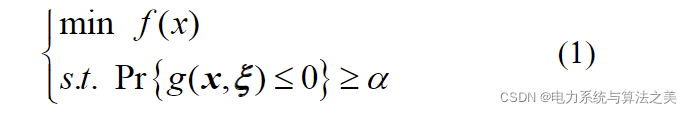
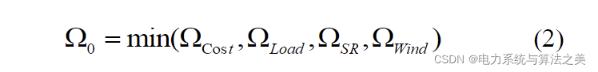
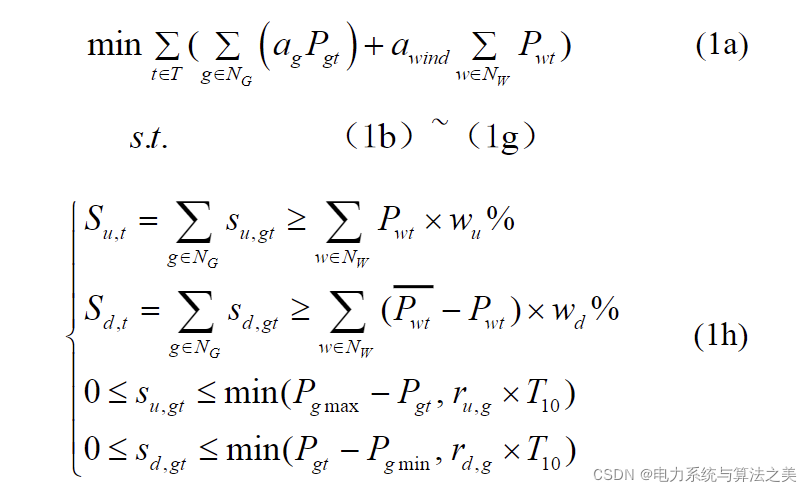
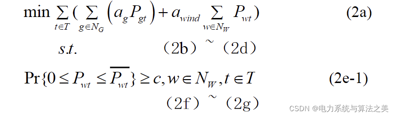
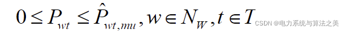
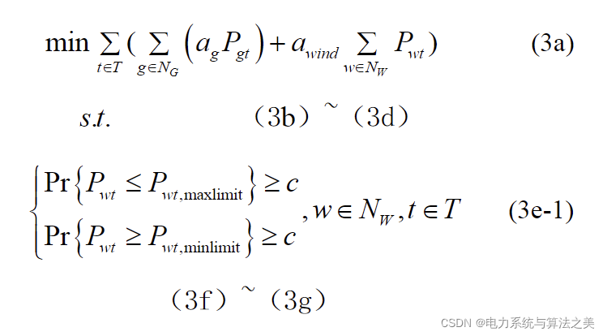
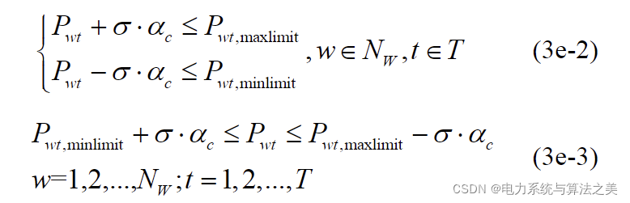
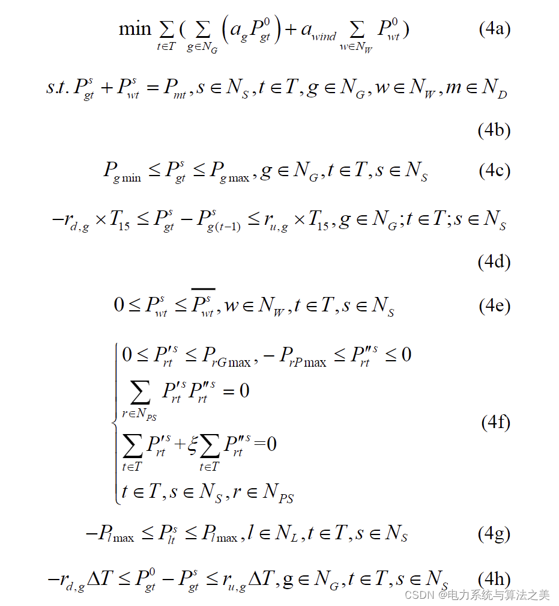
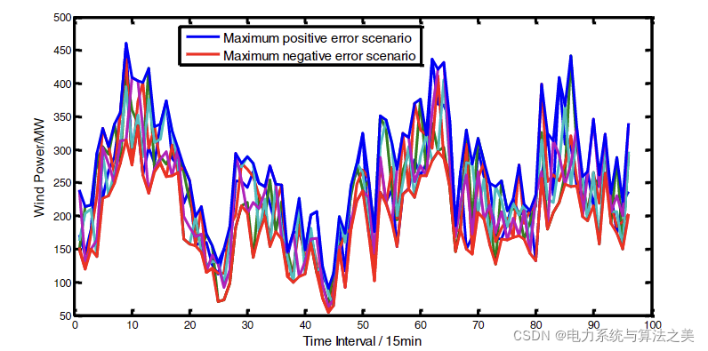
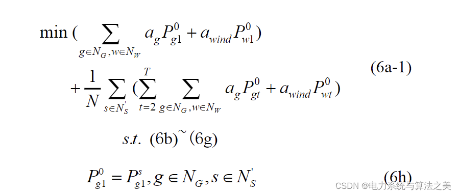
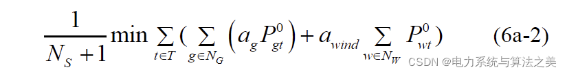

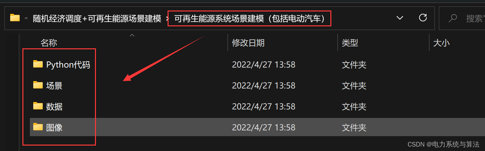
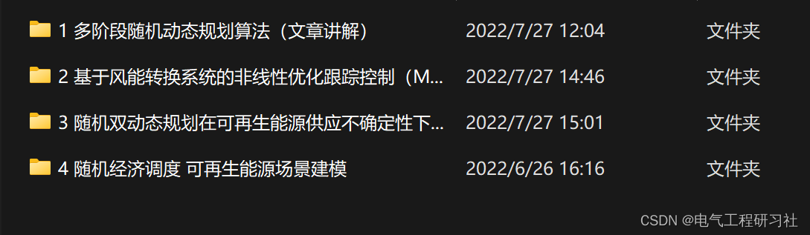

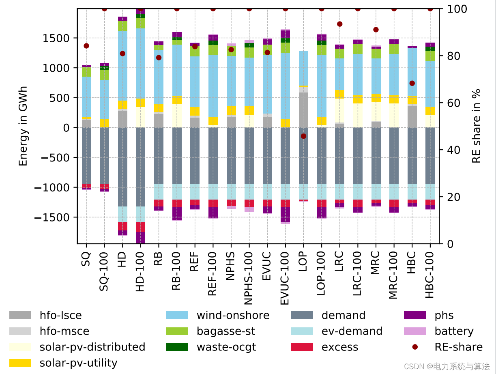
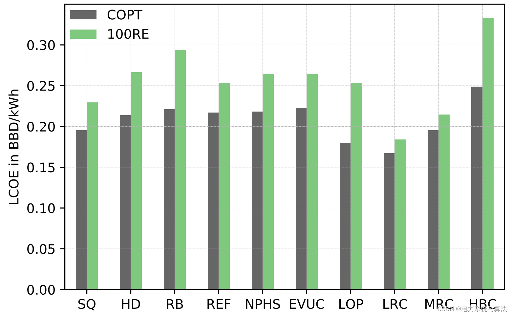

<!-- PAYMENT_BLOCK -->

## Get this dataset

- Payment link (Stripe): [Buy now](https://buy.stripe.com/3cs8yP7sY87d0vu9AB)
- Payment QR code: 

<!-- /PAYMENT_BLOCK -->
